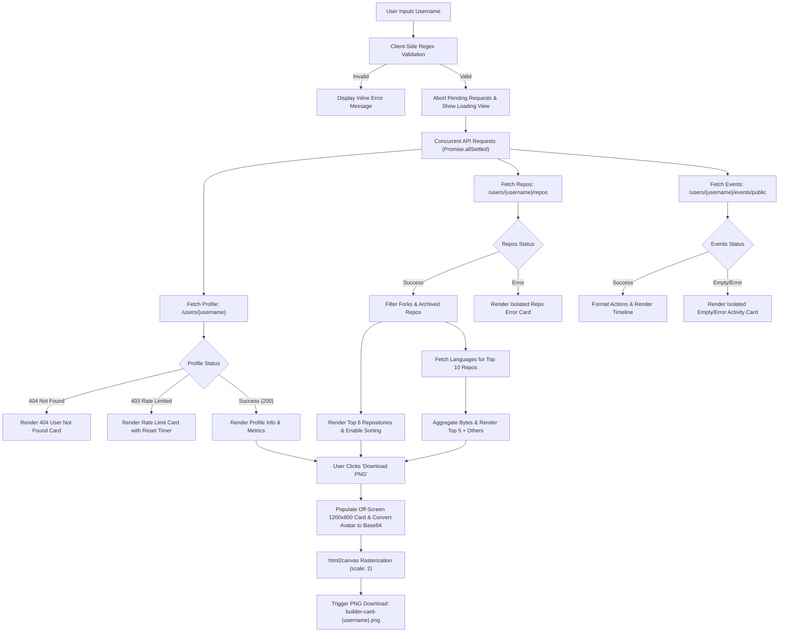

# Builder Card

> "Your GitHub journey, beautifully presented."

[](https://builder-card-mocha.vercel.app)
[](https://github.com/kollisaisiddu21-dev/Builder_Card)

A high-performance, responsive developer analytics dashboard that turns any public GitHub username into an elegant, shareable developer profile card with real-time statistics, top repositories, language analytics, and public activity history.

🌐 **Live Deployment:** [https://builder-card-mocha.vercel.app](https://builder-card-mocha.vercel.app)

---

## Table of Contents

- [A. Project Title and Tagline](#a-project-title-and-tagline)
- [B. Project Overview](#b-project-overview)
- [C. Features](#c-features)
- [D. Technologies Used](#d-technologies-used)
- [E. Application Workflow](#e-application-workflow)
- [F. API Endpoints Used](#f-api-endpoints-used)
- [G. Installation and Local Setup](#g-installation-and-local-setup)
- [H. Project Structure](#h-project-structure)
- [I. Known Limitations](#i-known-limitations)
- [J. Future Improvements](#j-future-improvements)
- [K. Author and Acknowledgments](#k-author-and-acknowledgments)

---

## A. Project Title and Tagline

- **Project Title:** Builder Card
- **Tagline:** *"Your GitHub journey, beautifully presented."*
- **Live Deployment:** [https://builder-card-mocha.vercel.app](https://builder-card-mocha.vercel.app)
- **Source Code Repository:** [https://github.com/kollisaisiddu21-dev/Builder_Card](https://github.com/kollisaisiddu21-dev/Builder_Card)
- **Description:** Builder Card is a client-side web application designed to synthesize a developer's GitHub journey into a sleek, presentation-ready profile card and real-time analytics dashboard. By querying public GitHub REST endpoints, it visualizes core developer statistics, featured open-source repositories, language distributions, and recent commit/pull-request activity—with full support for high-resolution PNG export.

---

## B. Project Overview

### Purpose
**Builder Card** transforms raw GitHub developer data into a visually compelling digital identity card and analytics dashboard. Rather than navigating through disjointed tabs on GitHub, developers, recruiters, and peers can view a developer's core competencies, active contributions, top projects, and language specializations at a single glance.

### The Problem It Solves
Standard GitHub profiles focus heavily on chronological feeds and lists, which can make it time-consuming to evaluate a developer's primary languages, recent momentum, or standout repositories. Builder Card solves this by querying GitHub's public REST APIs, aggregating byte-level language data, filtering out unoriginal forks and archived projects, and generating both an interactive dashboard and an exportable 2x Retina PNG card.

### Target Audience
- **Software Engineers & Open-Source Contributors:** Showcase achievements and top repositories on personal portfolio sites, LinkedIn, or Twitter.
- **Computer Science Students & Bootcamp Graduates:** Create a professional developer summary to attach to job applications, portfolios, and resumes.
- **Technical Recruiters & Engineering Managers:** Rapidly assess a candidate's primary programming languages, recent public activity, and repository quality.

---

## C. Features

All features listed below are fully implemented, verified, and active in the application:

### 1. Developer Profile Display
- **Visual Identity:** High-resolution avatar with gradient ring, display name, `@username` handle, and account age badge (`Joined YYYY`).
- **Bio & Metadata:** Bio display with graceful fallback, location indicator, company affiliation, and clickable external blog/portfolio link with protocol sanitization.
- **Key Metrics Row:** Stat cards for public repository count, followers, and following count with human-readable compact formatting (e.g., `1.2k`).

### 2. Repository Showcase & In-Memory Sorting
- **Curated Selection:** Excludes forked and archived repositories to emphasize genuine, original open-source work.
- **Top 6 Projects:** Showcases the developer's top projects with repository names, star counts, fork counts, primary language color indicator, and clean clamped descriptions.
- **Instant Sorting:** Interactive tab toggle between **"Most Starred"** and **"Recently Updated"** with zero secondary network calls.
- **Direct GitHub Navigation:** Each card links directly to the public GitHub repository with `target="_blank"` and `rel="noopener noreferrer"`.

### 3. Programming Language Analytics
- **Byte-Level Precision:** Fetches raw language byte statistics from `/repos/{owner}/{repo}/languages` across the user's top 10 starred repositories.
- **Proportional Progress Bar:** Multi-segment horizontal progress bar visually mapping language distribution.
- **Top 5 + "Others" Aggregation:** Categorizes the top 5 languages individually and groups remaining languages into an "Others" category, guaranteeing an exact 100% total.
- **In-Memory Caching:** Uses a JavaScript `Map` cache to avoid duplicate API calls during sorting or re-searching.
- **Resilience:** Built with `Promise.allSettled()` to compute and render statistics even if individual repository language requests fail.

### 4. Recent GitHub Activity Timeline
- **Public Event Feed:** Fetches the 10 most recent public events from `/users/{username}/events/public`.
- **Intelligent Event Formatting:** Translates raw event types into clear human actions:
  - `PushEvent`: *"Pushed X commits to <branch>"*
  - `PullRequestEvent`: *"<Action> pull request #<number>: <title>"*
  - `IssuesEvent`: *"<Action> issue #<number>: <title>"*
  - `IssueCommentEvent`: *"Commented on issue/pull request #<number>"*
  - `WatchEvent`: *"Starred repository"*
  - `ForkEvent`: *"Forked repository to <forkee>"*
  - `CreateEvent`: *"Created repository"* or *"Created branch/tag <ref>"*
  - `DeleteEvent`: *"Deleted <ref_type> <ref>"*
  - `ReleaseEvent`: *"Published release <tag/name>"*
- **Relative Timestamps:** Real-time elapsed time calculation (*"Just now"*, *"X minutes ago"*, *"X hours ago"*, *"X days ago"*, or calendar date).
- **Visual Markers:** Color-coded event marker badges and connected vertical timeline styling.

### 5. Builder Card PNG Export
- **Dedicated 1200 × 800 px Card:** Off-screen rendering container styled with high-contrast glassmorphic panels and dark navy accents, formatted at a 3:2 aspect ratio ideal for social sharing.
- **Retina 2x Resolution:** Exported at `scale: 2` via `html2canvas` generating a crisp 2400 × 1600 physical pixel PNG.
- **CORS-Safe Avatar Pipeline:** Converts external GitHub avatars to Base64 data URIs before canvas drawing to eliminate cross-origin taint errors (`SecurityError`), with an SVG vector fallback.
- **Feedback & Concurrency Protection:** Button state transitions from *"Download PNG"* to *"Generating..."* (with spinner), and *"Downloaded!"* (emerald confirmation badge) while blocking duplicate clicks.

### 6. Responsive UI & Accessibility (WCAG AA)
- **Mobile-to-Desktop Layouts:** Fluid CSS Grid and Flexbox layouts tested across 360px mobile viewports, tablets, and 1440px desktop screens.
- **Keyboard Navigation:** High-contrast visible focus indicators (`:focus-visible`) across all interactive buttons, inputs, links, and sorting tabs.
- **Screen Reader Support:** Semantic HTML5 elements (`<header>`, `<main>`, `<section>`, `<article>`), ARIA labels, and live regions (`aria-live="polite"`).

### 7. Comprehensive Error Handling & Fault Isolation
- **Client-Side Validation:** Validates usernames against GitHub's naming rules before firing network requests (max 39 characters, alphanumeric with single hyphens, no consecutive `--`).
- **Differentiated Error Views:**
  - `404 Not Found`: Displays user-not-found card with the searched username.
  - `403 / 429 Rate Limit`: Detects GitHub quota exhaustion, reads `X-RateLimit-Reset`, and shows an active reset countdown.
  - `403 Organization Block`: Differentiates rate limiting from private enterprise SSO or permission restrictions.
  - `5xx Server Downtime`: Informs the user of GitHub infrastructure downtime cleanly.
  - `Network Offline`: Captures loss of internet connectivity gracefully.
- **Race Condition Prevention:** Utilizes `AbortController` and sequential request IDs to cancel outdated in-flight requests when a user searches multiple times rapidly.
- **Fault-Isolated Sections:** Uses `Promise.allSettled()` so that a failure in repository or activity retrieval does not prevent the profile or language sections from rendering.
- **Strict XSS Defense:** All dynamic API strings are inserted via `textContent` or `document.createTextNode()`, and external links undergo URL protocol validation.

---

## D. Technologies Used

| Technology | Purpose | Rationale |
| :--- | :--- | :--- |
| **HTML5** | Semantic Structure & Accessibility | Uses native `<header>`, `<main>`, `<section>`, `<article>`, and ARIA attributes for clean markup and screen reader compatibility. |
| **CSS3** | Styling & Design System | Built using CSS Custom Properties (`:root`), glassmorphism (`backdrop-filter`), CSS Grid, and Flexbox with zero CSS framework overhead. |
| **Vanilla JavaScript (ES6+)** | Application Logic & State | Modern asynchronous JavaScript (`async`/`await`, `fetch`, `AbortController`, `Map`) delivering high performance without build steps or bundlers. |
| **GitHub REST API (v3)** | Data Ingestion | Reliable, standardized endpoints providing developer profiles, repositories, language statistics, and public events. |
| **html2canvas (v1.4.1)** | Client-Side PNG Export | Pure browser-side HTML-to-Canvas rasterization packaged locally in `assets/` with CDN fallback for offline reliability. |

### Architectural Decisions
- **Zero Build Tools:** No Webpack, Vite, Babel, or npm dependencies are required. The project runs immediately in any modern browser.
- **Zero Heavy Frameworks:** Eliminates the bloat of React, Vue, or Angular for a lightning-fast initial load time (< 50ms locally).
- **Standards-Compliant:** Adheres strictly to modern web standards for maximum browser longevity and portability.

---

## E. Application Workflow

The diagram and steps below illustrate the end-to-end lifecycle of a user search and profile card generation:



### Detailed Execution Stages
1. **Input Normalization & Validation:** Trims whitespace and tests username syntax against GitHub's format (`/^[a-zA-Z0-9](?:[a-zA-Z0-9]|-(?=[a-zA-Z0-9])){0,38}$/`).
2. **Race-Condition Cancellation:** If a previous search is pending, `AbortController.abort()` cancels the active HTTP connections to protect quota and prevent stale renders.
3. **Concurrent Data Fetching:** Dispatches profile, repository, and event requests in parallel via `Promise.allSettled()`.
4. **Profile Rendering:** Computes account age, formats metrics, sanitizes external URLs, and displays the main profile card.
5. **Repository Processing:** Discards forks and archives, sorts repositories by stars, renders the top 6 project cards, and caches data for instant toggle between star and update sorting.
6. **Language Aggregation:** Queries the languages endpoint for up to 10 top-starred repositories, sums byte totals, calculates percentages, groups the top 5 plus "Others", and renders the multi-colored breakdown bar.
7. **Recent Activity Timeline:** Parses recent events, resolves actor and repository details, calculates relative timestamps, and renders the activity feed.
8. **PNG Export:** On download click, copies current profile data into the fixed 1200 × 800 px export container, fetches the avatar as Base64 to bypass canvas tainting, runs `html2canvas` at 2x Retina scale, and triggers the file download.

---

## F. API Endpoints Used

All requests target the official GitHub REST API (v3) using `Accept: application/vnd.github.v3+json`.

| Endpoint | Method | Key Parameters | Purpose in Builder Card |
| :--- | :---: | :--- | :--- |
| `https://api.github.com/users/{username}` | `GET` | None | Retrieves primary user profile: avatar, name, bio, location, company, blog, public repos, followers, and account creation date. |
| `https://api.github.com/users/{username}/repos` | `GET` | `per_page=100`, `sort=updated` | Fetches up to 100 repositories to filter original work, sort by stars/updates, and identify featured projects. |
| `https://api.github.com/repos/{owner}/{repo}/languages` | `GET` | None | Returns byte-level language counts for a specific repository to calculate aggregate language distribution. |
| `https://api.github.com/users/{username}/events/public` | `GET` | `per_page=10` | Retrieves the 10 most recent public events to render the real-time activity timeline. |

---

## G. Installation and Local Setup

Builder Card requires no build steps, compilers, or package installations.

### 🌐 Instant Access (Live Deployment)
You can immediately access and test the application directly in your browser without any installation:
👉 **[https://builder-card-mocha.vercel.app](https://builder-card-mocha.vercel.app)**

---

### Local Setup Instructions

#### Prerequisites
- Any modern web browser (Google Chrome, Mozilla Firefox, Microsoft Edge, or Apple Safari).
- *(Recommended)* A lightweight static HTTP server (Python, Node.js, or VS Code Live Server) to allow smooth cross-origin canvas rendering.

#### Step-by-Step Instructions

##### 1. Obtain the Project Files
Clone the repository from GitHub:
```bash
git clone https://github.com/kollisaisiddu21-dev/Builder_Card.git
cd Builder_Card
```

Or navigate to the local project directory on your machine:
```bash
cd "c:\Users\Kolli Sai Siddu\OneDrive\Documents\builder-card"
```

##### 2. Start a Local Web Server

**Using Python 3 (Installed on most systems):**
```bash
python -m http.server 5173
```

**Using Node.js (`npx`):**
```bash
npx serve -l 5173
```

**Using VS Code Live Server:**
Right-click `index.html` in the file tree and select **"Open with Live Server"**.

##### 3. Open the Application
Navigate to the following address in your browser:
```text
http://localhost:5173
```

##### 4. Search for a GitHub Developer
Enter any valid public GitHub username into the search bar (e.g., `torvalds`, `gaearon`, `sindresorhus`, or your own username) and press **Enter** or click **"Generate Card"**.

---

## H. Project Structure

```text
builder-card/
├── index.html          # Semantic HTML5 markup, accessibility attributes, off-screen export template
├── style.css           # Design tokens, glassmorphic card styles, responsive layout rules
├── script.js           # API services, validation, sorting engine, language analytics, DOM renderer
├── README.md           # Comprehensive project documentation and architecture guide
├── .gitignore          # Excludes operating system metadata, editor settings, and temporary files
└── assets/             # Local static dependencies and documentation
    ├── html2canvas.min.js # Standalone offline library for client-side PNG card generation
    └── README.txt      # Asset documentation explaining dependency version and usage
```

### File Responsibilities
- **`index.html`**: Defines the semantic application layout including the navigation bar, search input, status containers (loading skeleton, rate limit, 404, server error), profile card, repository grid, language analytics section, activity timeline, and the hidden 1200 × 800 px export container.
- **`style.css`**: Contains the complete visual design system organized via CSS custom variables (`--bg-primary`, `--accent-blue`, etc.), glassmorphic backdrop filters, grid systems, responsive media queries, and high-contrast accessibility focus states.
- **`script.js`**: Houses all application logic: input validation, asynchronous network requests with `AbortController`, error state management, repository sorting, language byte aggregation, relative time computation, and the PNG export pipeline.
- **`assets/html2canvas.min.js`**: Version 1.4.1 of the html2canvas library, ensuring the application can export PNG cards offline or in restricted network environments without external CDN calls.
- **`.gitignore`**: Prevents operating system artifacts (`.DS_Store`, `Thumbs.db`), IDE configuration folders (`.vscode/`, `.idea/`), and temporary debug logs from entering version control.

---

## I. Known Limitations

1. **GitHub API Unauthenticated Rate Limits:**
   - Unauthenticated requests from a single IP address are limited by GitHub to **60 requests per hour**.
   - Searching multiple profiles in rapid succession may temporarily trigger a rate limit (`403 Forbidden`). When this occurs, Builder Card automatically displays the exact reset time countdown retrieved from the `X-RateLimit-Reset` HTTP header.
2. **Public Data Exclusivity:**
   - The application strictly queries public GitHub endpoints. Private repositories, private contributions, and organization-restricted private events cannot be accessed.
3. **Activity Window Constraints:**
   - GitHub's public events API (`/events/public`) only retains activity from the past **90 days** or up to **300 events**. For inactive accounts, an informative empty state is displayed.
4. **Language Analysis Quota Protection:**
   - To conserve the 60 request/hour rate limit, language analysis evaluates up to the **top 10 starred original repositories**. Repository counts beyond 10 are not queried to prevent exhausting the user's hourly quota.

---

## J. Future Improvements

The following features represent potential enhancements for future iterations of Builder Card:
- **Personal Access Token (PAT) / OAuth Integration:** Allow users to provide a personal GitHub token or sign in via OAuth to increase the rate limit ceiling from 60 to 5,000 requests per hour.
- **Developer Comparison Mode:** A dual-column layout allowing two GitHub developers to be compared side-by-side on stars, languages, and activity.
- **GitHub Contribution Heatmap:** Visual SVG generation of the developer's annual commit graph directly inside the Builder Card dashboard.
- **Custom Card Themes & Dimensions:** Enable users to customize their downloadable card with light/dark modes, custom accent gradients, or vertical story formats for Instagram/mobile sharing.
- **Advanced Collaboration Metrics:** Deeper analytics showing pull request merge velocity, issue closing ratio, and frequent open-source collaborators.

---

## K. Author and Acknowledgments

### Author
- **Developer:** [Kolli Sai Siddu](https://github.com/kollisaisiddu21-dev)
- **Project Repository:** [Builder_Card](https://github.com/kollisaisiddu21-dev/Builder_Card)
- **Live Deployment:** [https://builder-card-mocha.vercel.app](https://builder-card-mocha.vercel.app)

### Acknowledgments
- **[GitHub REST API](https://docs.github.com/en/rest)** for providing accessible public developer statistics.
- **[html2canvas](https://html2canvas.hertzen.com/)** by Niklas von Hertzen for client-side HTML canvas rendering.
- **[Inter Font Family](https://rsms.me/inter/)** by Rasmus Andersson for clean typography.
- **[Vercel](https://vercel.com/)** for seamless global deployment and edge hosting.
